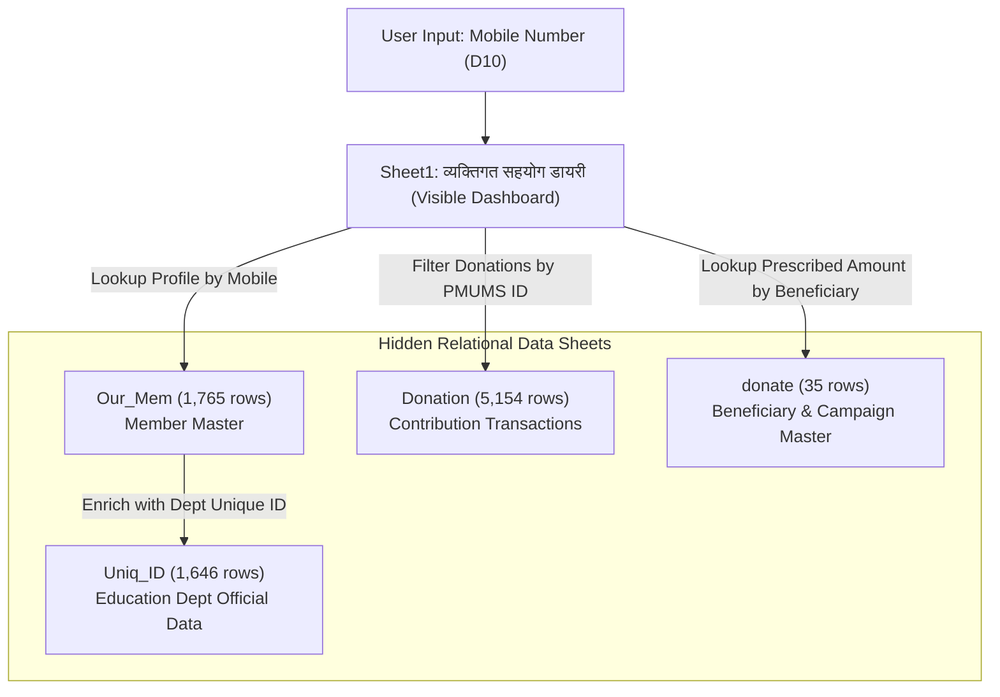

# PMUMS Diary.xlsx — Technical Analysis & System Documentation

## 1. Executive Summary

**`PMUMS Diary.xlsx`** is an automated personal welfare contribution passbook (व्यक्तिगत सहयोग डायरी) created for the **PMUM Shikshak Sangh Madhya Pradesh (PMUM शिक्षक संघ मप्र)** under its **Karmachari Kalyan Kosh Yojana (कर्मचारी कल्याण कोष योजना)**.

The workbook functions as a searchable digital member ledger and verification passbook. By entering an enrolled teacher's 10-digit mobile number, the sheet automatically searches the backend member databases, retrieves their official profile, and populates a complete transaction statement of all bereavement welfare contributions (सहयोग राशि) made by the member to the families of deceased fellow teachers.

---

## 2. Organization & Welfare Scheme Context

- **Organization**: PMUM शिक्षक संघ मप्र (Prathmik Madhyamik Utkrisht / Adhyapak Shikshak Sangh, Madhya Pradesh)
- **Scheme**: कर्मचारी कल्याण कोष योजना (Employee Welfare Fund Scheme)
- **Core Mottos**:
  - *"शिक्षक एकता - हमारी शक्ति - सहयोग हमारा कर्तव्य"* (Teacher Unity - Our Strength - Mutual Support Our Duty)
  - *"मेरा सहयोग - मेरा संकल्प"* (My Support - My Resolution)
  - *"दिवंगत शिक्षक/ कर्मचारी के परिवार के साथ हमारा सहयोग, हमारी एकता का प्रतीक"* (Our solidarity with the family of a deceased teacher/employee is the symbol of our unity)
- **Primary Operational Area**: Madhya Pradesh (predominantly Gwalior Division & Shivpuri District, with beneficiary outreach statewide)
- **Workbook Author & IT Cell In-charge**: Sanjay Jain (Mobile: `8878543227`)
- **District In-charge / President**: Avadesh Shrivastav (Mobile: `8120629942`)

---

## 3. Architecture & Sheet Breakdown

The workbook consists of **5 sheets** — 1 visible front-end user interface and 4 hidden relational backend data sheets:



### Detailed Sheet Inventory

| Sheet Name | State | Rows | Cells | Primary Purpose |
| :--- | :--- | :--- | :--- | :--- |
| **`Sheet1`** | **Visible** | 38 | 55 | **Interactive Member Diary (Frontend UI)**. Allows mobile-based search, profile rendering, auto-numbered donation passbook, and print-ready layout. |
| **`Our_Mem`** | Hidden | 1,765 | 22,730 | **Union Member Master Directory**. Stores member names, PMUMS IDs, phone numbers, schools, blocks, and linked department IDs. |
| **`Donation`** | Hidden | 5,154 | 41,201 | **Donation Transaction Log**. Comprehensive record of individual donations made by members for deceased colleagues. Contains cloud sync link in `A1`. |
| **`donate`** | Hidden | 35 | 171 | **Beneficiary & Campaign Master**. Catalog of 25 beneficiaries across 9 donation drives (Dec 2025 – Sep 2026), contribution rules (₹60–₹190), and collected aid. |
| **`Uniq_ID`** | Hidden | 1,646 | 26,228 | **Departmental Master Dump**. Raw export from the MP Education Department portal ("Joining Date Report") containing Employee Unique IDs, joining/retirement dates, and emails. |

---

## 4. How the System Works (Data Flow & Logic)

### Step 1: Member Identification (`Sheet1!D10` ➡️ `D11`)
1. The user inputs their **10-digit mobile number** into cell **`D10`**.
2. Cell **`D11`** (रजिस्ट्रेशन नंबर / PMUMS ID) cleans the input using regular expressions, strips non-numeric characters, takes the rightmost 10 digits, and matches against `Our_Mem!E` (Mobile column):
   ```excel
   =IF(D10="","", IF(LEN(REGEXREPLACE(TO_TEXT(D10),"[^0-9]",""))<10, "", 
     IFERROR(XLOOKUP(RIGHT(REGEXREPLACE(TO_TEXT(D10),"[^0-9]",""),10), 
     ARRAYFORMULA(RIGHT(REGEXREPLACE(TO_TEXT(Our_Mem!E4:E38),"[^0-9]",""),10)), 
     Our_Mem!B4:B38, ""), "")))
   ```

### Step 2: Member Profile Retrieval (`Sheet1` Rows 10–13)
Using the resolved PMUMS ID (`$D$11`), `Sheet1` executes `XLOOKUP` queries to populate member metadata from `Our_Mem`:
- **यूनिक आईडी (Dept Employee Code - `G10`)**: `XLOOKUP($D$11, Our_Mem!$B, Our_Mem!$M)`
- **स्कूल का नाम (School - `G11`)**: `XLOOKUP($D$11, Our_Mem!$B, Our_Mem!$K)`
- **नाम सदस्य (Member Name - `D12`)**: `XLOOKUP($D$11, Our_Mem!$B, Our_Mem!$A)`
- **ब्लॉक (Block - `G12`)**: `XLOOKUP($D$11, Our_Mem!$B, Our_Mem!$J)`
- **पंजीयन दिनांक (Registration Date - `D13`)**: Formats date string from `Our_Mem!$L` (`dd/mm/yyyy`).
- **जिला (District - `G13`)**: `XLOOKUP($D$11, Our_Mem!$B, Our_Mem!$I)`

### Step 3: Dynamic Donation Statement Generation (`Sheet1` Rows 16–26)
Below the member profile is the **सहयोग विवरण रजिस्टर (Contribution Ledger Table)**:
1. **Beneficiary & Contribution Date (`C17:D17`)**:
   Dynamically filters all donation entries matching the member's PMUMS ID (`$D$11`):
   ```excel
   =FILTER({Donation!$J$4:$J38, INDEX(TEXT(Donation!$K$4:$K38, "dd/mm/yyyy"))}, Donation!$B$4:$B38 = $D$11)
   ```
   - Column `C`: दिवंगत शिक्षक का नाम (Deceased teacher's name / beneficiary)
   - Column `D`: सहयोग की तिथि (Date on which the donation was logged)
2. **Dynamic Serial Numbering (`B17`)**:
   ```excel
   =IF($D$11="","", SEQUENCE(COUNTA($C$17:C24), 1))
   ```
   Generates a sequential count `(1, 2, 3...)` based on the number of non-empty beneficiary records returned.
3. **Prescribed Contribution Amount (`E17:E26`)**:
   ```excel
   =IFNA(XLOOKUP(C17, donate!$D$3:$D35, donate!$J$3:$J35), "")
   ```
   Fetches the standard mandated contribution amount (₹60, ₹80, ₹100, ₹170, ₹180, ₹190) from the master campaign sheet `donate`.
4. **Physical Verification Fields (Columns F, G, H)**:
   - **भुगतान का माध्यम (Payment Mode)**: Mode used by member (UPI, PhonePe, GPay, Netbanking).
   - **खाता नम्बर / UPI ID**: Source account/UPI ID from which payment was remitted.
   - **रिमार्क (Remarks)**: UTR / Transaction ID / Notes.

### Step 4: Member Compliance & Physical Audit Trail
At the bottom of the passbook:
- **Cell C33**: *"नोट - यह जानकर बेबसाइट के आधार पर, इसे अंतिम जानकारी न समझा जाए।"* (Advisory that data reflects portal records as-is).
- **Cell C34**: *"नोट - कृपया आपके द्वारा किए गए सहयोग के पेमेंट स्लिप के स्क्रीनशॉट के प्रिंट आउट निकालकर फाइल बनाकर रखें।"* (Mandatory guideline urging members to maintain printed screenshot proof of each payment in an audit file).

---

## 5. Detailed Backend Data Schemas

### 1. `Our_Mem` (Member Master — 1,762 Active Records)
- **Column A (`NAME`)**: Concatenated full name via formula: `={"NAME"; IF(C4:C1765="", "", C4:C1765 & " " & D4:D1765)}`
- **Column B (`PMUMS ID`)**: Unique union registration key (e.g. `PMUMS2014136`).
- **Column C (`Name`)**: First / Middle name.
- **Column D (`Sir name`)**: Surname.
- **Column E (`Mob. No.`)**: 10-digit mobile number.
- **Column F (`Department`)**: `शिक्षा विभाग` (Education Department).
- **Column G (`State`)**: `Madhya Pradesh`.
- **Column H (`Div`)**: Division (e.g. `Gwalior`).
- **Column I (`Dist.`)**: District (e.g. `Shivpuri`).
- **Column J (`Block`)**: Block (e.g. `Pohri`, `Shivpuri`, `Kolaras`, `Karaira`, `Khaniyadhana`, `Pichhore`).
- **Column K (`School Name`)**: Assigned institution (e.g. `GHSS Jhiri`).
- **Column L (`Reg. Date`)**: Union onboarding timestamp.
- **Column M (`Uniq ID`)**: State Education Employee ID linked dynamically to `Uniq_ID`:
  ```excel
  =VSTACK("Uniq ID", XLOOKUP(TRIM($B$4:B1765), Uniq_ID!B4:B1765, Uniq_ID!K4:K1765, 0))
  ```

### 2. `donate` (Campaign & Beneficiary Master — 25 Beneficiaries)
Contains all completed and active welfare drives organized across Madhya Pradesh:

| Drive (सहयोग क्र.) | Beneficiary (लाभार्थी) | District | Campaign Month | Mandated Aid (₹) | Total Disbursed (₹) |
| :---: | :--- | :--- | :--- | :---: | :---: |
| 1 | स्व. श्री दिलीप सिंह लोधी | Damoh | December 2025 | ₹100 | — |
| 2 | श्री राकेश कुमार अहिरवार | Datia | January 2026 | ₹80 | — |
| 3 | श्री किशुन प्रसाद लडिया | Damoh | February 2026 | ₹60 | — |
| 4 | स्व. श्री रेवाराम अलोन जी / श्री महेंद्र सिंह मुवेल | Dhar | April 2026 | ₹100 | — |
| 5 | स्व श्री बृजेश कुमार श्रीवास / श्री राजकुमार सिरोतियाँ | Narsinghpur / Burhanpur | May 2026 | ₹100 | — |
| 6 | स्व. चंद्रप्रकाश जोशी / श्यामकिशोर सोनी / कृष्णकुमार / अमित असाटी | Dewas / Betul / Balaghat / Damoh | June 2026 | ₹180 | — |
| 7 | स्व. कमलसिंह / मुकेश दादौरिया / महेश जाटव / राजेंद्र अवधिया | Sheopur / Dewas / Seoni / Raisen | July 2026 | ₹170 | — |
| 8 | स्व. नितिन जैन / राम राजा / रमेश शर्मा / रामकुमार त्यागी / फिरोज अली | Dhar / Datia / Khargone / Morena / Gwalior | August 2026 | ₹190 | ₹26,50,000 / ₹26,37,000 |
| 9 | स्व. राधेश जोशी / नंदकिशोर बिसेन / देवका ठाकुर / बलराम मरावी / शंभू लाल | Dhar / Seoni / Damoh / Mandla / Neemuch | September 2026 | ₹170 | In Progress |

### 3. `Donation` (Transaction Ledger — 5,151 Records)
- **Cell A1**: Cloud source URL (`https://docs.google.com/spreadsheets/d/1qBGM5bM9soov9sHRYXuwRqc0ZjsTmi8TZyj8Tz-RtWs/edit?usp=sharing`).
- Log of 5,151 donations contributed by 1,309 unique contributing members.
- Columns: `S.No.`, `PMUMS ID`, `नाम सदस्य`, `संभाग`, `जिला`, `ब्लॉक`, `स्कूल का नाम`, `लाभार्थी`, `सहयोग तिथि` (stored as serial timestamps up to Sept 2026).

### 4. `Uniq_ID` (Official Government Master — 1,643 Records)
- Official HR record from the MP Education portal.
- Fields: `Report`, `User ID`, `Name`, `Email`, `Mobile`, `State`, `Sambhag`, `District`, `Block`, `Department`, `Department Unique ID` (e.g. `BB1045`, `BB5945`, `BW8663`), `School/Office`, `Joining Date`, `Retirement Date`, `Registration Date`, `Status` (`ACTIVE`).

---

## 6. Critical Technical Observations & Recommendations

### ⚠️ 1. Hardcoded Row Limit Range Bug in `Sheet1`
In `Sheet1`, the lookup formulas reference rows 4 to 38 only (`$B$4:$B38` or `E4:E38`):
- `G10`: `XLOOKUP($D$11, Our_Mem!$B$4:$B38, Our_Mem!$M$4:M38)`
- `D11`: `ARRAYFORMULA(RIGHT(REGEXREPLACE(TO_TEXT(Our_Mem!E4:E38), ...), 10))`
- `C17`: `FILTER({Donation!$J$4:$J38, ...}, Donation!$B$4:$B38 = $D$11)`

**Impact**: 
- `Our_Mem` has **1,765 rows**, and `Donation` has **5,154 rows**.
- Any member whose record lies on or below row 39 in `Our_Mem` cannot be retrieved via `Sheet1`!
- Similarly, donations appearing after row 38 in `Donation` will not show up in the passbook.

**Fix**: Update the formula range across `Sheet1`:
- Change `Our_Mem!$B$4:$B38` ➡️ `Our_Mem!$B$4:$B1765` (or `Our_Mem!B:B`)
- Change `Our_Mem!E4:E38` ➡️ `Our_Mem!E4:E1765`
- Change `Donation!$B$4:$B38` ➡️ `Donation!$B$4:$B5154` (or `Donation!B:B`)

---

### ⚠️ 2. Google Sheets vs. Microsoft Excel Formula Compatibility
The workbook was originally built in Google Sheets and downloaded as an `.xlsx` file.
- As a result, Google Sheets proprietary syntax like `REGEXREPLACE`, `TO_TEXT`, `ARRAYFORMULA`, and array literals `{Donation!$J, ...}` were exported as `__xludf.DUMMYFUNCTION(...)`.
- **Impact**: In native Microsoft Excel desktop application, formulas wrapped in `__xludf.DUMMYFUNCTION` will evaluate to `#NAME?` or fail to calculate unless opened in Google Sheets or rewritten using Excel-native functions (e.g., using `FILTER`, `TEXT`, `RIGHT`, `ISNUMBER`, `SEARCH`, etc.).

---

## 7. Summary Conclusion

The **`PMUMS Diary.xlsx`** is a well-structured, community-driven mutual aid management tool that connects ground-level teacher welfare donations directly with official government employee records. It bridges individual member accountability with transparent union administration. With the minor formula range updates and Excel-native function conversions noted above, it serves as a complete, auditable welfare diary system.
